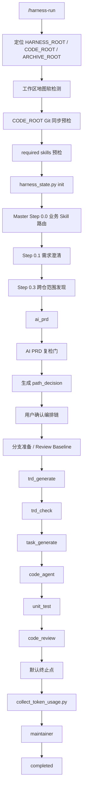

# ASM Harness 完整分析手册

本文基于当前仓库的 Harness v2 契约整理，覆盖入口、Master 编排、全部有效节点、停用节点、正常路径、异常路径、断点恢复、持久化数据、效果统计口径，以及面试中容易被追问的问题。

核心源文件：

- `.harness/runners/harness-run/SKILL.md`
- `.harness/runners/harness-resume/SKILL.md`
- `.harness/runners/harness-status/SKILL.md`
- `.harness/agents/master.md`
- `.harness/agents/pipeline.yaml`
- `.harness/agents/runtime-policy.yaml`
- `.harness/agents/revision-contract.md`
- `.harness/scripts/harness_state.py`
- `.harness/scripts/assemble_subagent_prompt.py`
- `.harness/scripts/validate_harness_contract.py`
- `.harness/scripts/collect_token_usage.py`
- `.harness/schemas/*.json`

## 1. Harness 是什么

ASM Harness 是一套由 LLM Agent 驱动的研发流水线编排系统。它把一次需求拆成阶段化、可恢复、可审计的生产和评审过程：

```text
需求分析 -> TRD -> 任务拆解 -> 代码生成 -> 单测 -> Code Review -> 可选集成测试 -> 可选部署 -> 维护收尾
```

它解决的不是“让一个 Agent 从头写到尾”的问题，而是把长期研发过程变成一个有状态机、有质量门禁、有失败回流、有断点恢复、有真实证据的控制系统。

### 1.1 核心设计原则

1. **Master 只编排，不代做**：Master 不写 TRD、不写代码、不代做单测和 Code Review。
2. **生产与评审分离**：`trd_generate` 与 `trd_check` 分离，`code_agent` 与 `unit_test/code_review` 分离。
3. **阶段产物驱动推进**：只有 `phase_results/{phase}.json.status=PASS` 且结构校验通过，才能推进。
4. **状态与真实效果对账**：不只相信 Agent 自报，Code Review 会用 Git baseline 与 `changes.md` 对账。
5. **危险操作必须确认**：范围确认、编排确认、部署确认、Apollo/DMS/SQL 等外部写操作都要人工确认。
6. **失败必须回流到根因阶段**：测试失败回 `code_agent`，设计错误回 `trd_generate`，需求变化回 `ai_prd`。
7. **断点可恢复**：state、scope、delegation、phase result、retry context、baseline、build id、Git 状态共同支撑恢复。

### 1.2 三个根目录

| 变量 | 含义 | 规则 |
|---|---|---|
| `HARNESS_ROOT` | `asm-tools/.harness` | 只放 Harness 配置、知识、脚本和执行档案 |
| `CODE_ROOT` | 业务代码仓，默认 `asm-service` | 业务代码检索、修改、测试、Git 操作只在此执行 |
| `ARCHIVE_ROOT` | `HARNESS_ROOT/memory/execution` | 所有任务档案的唯一读写目录 |

禁止把 `asm-tools` 当成业务仓，也禁止把任务档案写到业务仓的 `.harness/`。

### 1.3 四类执行角色

| 角色 | 例子 | 职责 |
|---|---|---|
| Planner | `ai_prd`、`deploy_plan` | 明确需求和计划 |
| Generator | `trd_generate`、`task_generate`、`code_agent`、`fe_codegen` | 生成产物 |
| Evaluator | `trd_check`、`unit_test`、`code_review`、`integration_test_check` | 独立评审质量 |
| Maintainer | `maintainer` | 总结经验、更新 pattern/anti-pattern、归档 |

`machine_integration` 和 `offline_init` 是特殊 Ops Generator，属于短路的业务 Skill 路由，不走标准代码流水线。

## 2. 总体流程图

### 2.1 标准大功能



### 2.2 小修复快速路径

```text
ai_prd
-> code_agent 快速模式
-> unit_test
-> self_review
-> maintainer
```

适用条件：纯修复、约 3 个文件以内、无新增 API、无新增 DB、无新增模块、无跨仓、不触碰 receive/chute、分表、wire、Kafka、thirdpart 等高风险路径。

### 2.3 Ops 短路路径

```text
Step 0.0 命中业务 Skill
-> machine_integration 或 offline_init
-> maintainer
```

跳过 `ai_prd` 之后的全部标准代码阶段，但仍要走任务档案、phase result、危险操作确认和真实执行记录。

### 2.4 前端 lane

```text
ai_prd
-> trd_generate
-> trd_check
-> task_generate（可选）
-> backend code_agent
-> frontend fe_codegen（每个前端仓独立 Agent）
-> backend unit_test / code_review
-> integration_test（可选）
-> maintainer
```

`fe_codegen` 只有在 `scope.json.frontend.repos` 非空且 `path_decision.fe_lane=true` 时启用。

## 3. 入口与启动规则

### 3.1 `/harness-run <TASK-ID> [PRD内容或PRD文件路径]`

`harness-run` 是启动新任务的唯一入口，不用于恢复或查看状态。

启动顺序：

1. 定位三个根目录。
2. 做工作区地图软检测。
3. 对 `CODE_ROOT` 做 Git 同步预检。
4. 做全部 required skills 预检。
5. 初始化任务档案。
6. 当前主 Agent 读取 Master 规则并开始编排。

### 3.2 工作区地图软检测

以 `dirname(CODE_ROOT)` 为 `WORKSPACE_ROOT`，读取 `WORKSPACE_ROOT/agents.md`，识别：

- `asm-service`
- `asm-local-service`
- `asm-protobuf`
- `ai-automation`
- `fms-instation`
- `asm-tools`

只有目录存在且是 Git 仓库才算 discovered repository。地图缺失、不可读或仓库未发现只提醒，不阻断，也禁止自动创建目录或推断范围。

### 3.3 Git 同步预检

先执行：

```bash
git fetch
git rev-parse --abbrev-ref --symbolic-full-name @{u}
git rev-list --left-right --count HEAD...@{u}
```

处理规则：

| 状态 | 行为 |
|---|---|
| 干净且只落后远端 | `git pull --ff-only` |
| 与远端一致 | 继续 |
| 仅本地领先 | 继续 |
| 工作区有改动 | 不自动合并、rebase、stash，询问用户 |
| 本地远端分叉 | 询问用户 |
| 无 upstream | 询问用户 |
| 网络失败 | 询问是否用当前版本继续 |

用户不确认时停止启动。禁止 `reset --hard`、`checkout -B`、自动 stash、丢弃改动。

### 3.4 Required Skills 预检

```bash
python3 "$HARNESS_ROOT/scripts/assemble_subagent_prompt.py" \
  --harness-root "$HARNESS_ROOT" \
  --code-root "$CODE_ROOT" \
  --validate-required-skills
```

任何 pipeline 配置的 required skill 缺失都阻断启动。

### 3.5 任务初始化

```bash
python3 "$HARNESS_ROOT/scripts/harness_state.py" \
  --harness-root "$HARNESS_ROOT" \
  --task-id "$TASK_ID" \
  init \
  --code-root "$CODE_ROOT" \
  --workspace-root "$WORKSPACE_ROOT" \
  --workspace-map-path "$WORKSPACE_MAP_PATH" \
  --discovered-repository "$REPO"
```

初始化 `state.json`，包含：

- `artifact_contract_version=2`
- `delegation_contract_version=1`
- `status=running`
- `current_phase=null`
- `phases_completed=[]`
- `delegations=[]`
- `orchestration_confirmation.status=pending`
- `affected_repos=[]`
- `workspace_root`
- `workspace_map_path`
- `discovered_repositories`
- `session_metrics`

如果任务目录已存在，`init` 拒绝覆盖。防止旧任务被当成新任务，也防止用 init 绕过确认。

## 4. Master 编排状态机

Master 是唯一编排者，但不是简单的 for-loop 调度器。它根据用户输入、证据、路径决策和阶段结果决定下一步。

### 4.1 顶层状态

`state.status` 支持：

- `running`
- `paused`
- `awaiting_human`
- `completed`
- `failed`

常见 `awaiting_human.gate_type`：

- `requirement_clarification`
- `path_decision_confirmation`
- `git_safety`
- `mock_refresh_blocked`
- `assumption_ambiguity`
- `fe_scope_resolution`
- `code_review_escalation`
- `deploy_execute`
- 环境或外部系统阻塞

### 4.2 Step 0.0：业务 Skill 路由

Master 判断需求是否命中：

- `machine-integration`
- `asm-offline-init`

命中时走 Ops Agent，短路标准 pipeline。

规则：

- 路由不确定时可以按 standard 初步分析，但未确认前不得派发下游。
- 用户否认 Ops 路由时改走标准 pipeline。
- 中途发现实际需要 Go 代码时，Ops Agent FAIL，回到标准路由和范围发现。

### 4.3 Step 0.1：需求澄清

只澄清会影响实现的内容：

- 需求歧义
- 边界条件
- 默认值
- 兼容性
- 线上行为
- 回退策略

未确认的关键语义不能由 Agent 猜测。需要人工输入时进入：

```json
{
  "status": "awaiting_human",
  "awaiting_human": {
    "gate_type": "requirement_clarification"
  }
}
```

### 4.4 Step 0.3：跨仓范围发现

候选后端仓：

- `asm-local-service`
- `asm-protobuf`

候选前端仓：

- `ai-automation`
- `fms-instation`

Master 输出每个仓库的：

- `likely_affected`
- `likely_unaffected`
- `uncertain`
- evidence
- reason

`scope.json` 固定包含：

- `version`
- `route`
- `backend`
- `frontend`
- `evidence`
- `pending_items`

范围只由实际代码、接口、proto、页面/API 消费等证据驱动，不能因为仓库存在就加入范围。

### 4.5 编排链确认

Master 读取 `ai_prd.md` 和 `## 编排信号`，生成：

- `selected_steps`
- `skipped_steps`
- `executor_plan`
- `model_choices`
- `reason`
- 风险说明
- 分支和 MR 计划
- 是否集成测试
- 是否部署
- 是否 maintainer

用户确认后执行：

```bash
harness_state.py confirm-path
```

确认写入：

- `orchestration_confirmation.status=confirmed`
- `confirmed_by`
- `confirmed_at`
- `decision_fingerprint`

指纹绑定 `path_decision`、`scope`、`affected_repos`。后续下游派发必须验证指纹，路径或范围变化会让旧确认失效。

### 4.6 分支准备与 Review Baseline

如果选择 `code_agent`，每个 affected repo 都要先做 Git 安全检查。

分支约定：

```text
source: feature/{JIRA}/harness-{user}
target: feature/{JIRA}-harness
```

禁止：

- `git checkout -B`
- `git reset --hard`
- force push
- stash 或丢弃用户改动

如果同时选择 `code_agent` 和 `code_review`，首次派发 `code_agent` 前创建 `review_baseline.json`，每个仓记录：

- `name`
- `root`
- `base_sha`
- `status_before`
- `created_at`

`base_sha` 是后续 Code Review 的唯一对账基线，repair round 不重置。

## 5. Phase 推进契约

### 5.1 每个 phase 的闭环

```text
读取 pipeline contract
-> assemble_subagent_prompt.py 生成 prompt
-> harness_state.py dispatch 写入 delegation
-> Sub-Agent 读取角色定义、Skill、Knowledge
-> Sub-Agent 产出 output artifacts
-> Sub-Agent 写 phase_results/{phase}.json
-> validate_harness_contract.py 结构校验
-> Master 读取 result
-> PASS 才追加 phases_completed
```

### 5.2 派发模式

| 模式 | 场景 | 要求 |
|---|---|---|
| `initial` | 新 phase 首次派发 | attempt=1，新 Agent |
| `continuation` | 同一 Agent 继续或修复 | 必须有 retry context，agent_id 不变 |
| `reset` | 范围、角色、规则、契约理解变化 | 新 Agent，attempt+1，写 reset_reason |
| `independent_review` | generator 修改后重新评审 | 新 Evaluator，记录 parent 信息 |

### 5.3 Retry Context

```json
{
  "task_id": "SPXFM-xxxx",
  "phase": "code_agent",
  "attempt": 2,
  "failure_reason": "...",
  "evidence_paths": [],
  "required_changes": [],
  "scope_invariants": [],
  "invalidated_outputs": []
}
```

字段必须与 delegation 匹配，路径必须位于任务档案内。

### 5.4 Validator 检查

`validate_harness_contract.py` 检查：

- state 存在且 contract version=2
- delegation 存在
- agent definition 存在
- phase result 存在且结构合法
- `executor.type` 正确
- `independent` 满足契约
- required outputs 声明齐全
- scope 与 state 一致
- work plan 覆盖映射
- review baseline 存在
- Code Review 的 Git diff 对账
- assumption anchoring
- deploy git sync
- feedback schema

不能用聊天总结、Todo completed、临时命令输出或 Agent 自报 PASS 替代。

## 6. 全部节点详解

### 6.1 `ai_prd`

**角色**：Planner，非独立评审。

**输入**：

- `user_brief.md`
- `scope.json`
- 用户澄清结果
- ASM Knowledge

**输出**：

- `ai_prd.md`
- `phase_results/ai_prd.json`

`ai_prd.md` 必须包含：

- 背景与目标
- 需求范围
- 功能点
- 非功能要求
- 约束与依赖
- 验收标准
- 风险与待确认项
- 需求澄清结果
- `asm-KB 检索摘要`
- `编排信号`

`asm-KB 检索摘要` 固定五字段：

1. 检索关键词
2. 命中文件
3. 实际读取
4. 跳过文件
5. 编排影响

`编排信号` 至少包括：

- 变更类型
- 涉及模块
- 新增 API
- 新增 DB 表
- 跨双仓
- 核心路径
- receive 是否无 HTTP
- 是否分表查询
- 新增错误码
- Kafka
- thirdpart
- wire
- 前端
- 离线一致性风险

**回流**：FAIL 时回到 `ai_prd` 修复。

### 6.2 `trd_generate`

**角色**：Generator，P0。

**输入**：

- `ai_prd.md`
- `scope.json`

**输出**：

- `trd.md`
- `codebase_evidence.md`
- `phase_results/trd_generate.json`

必须使用 `spx_trd_gen/SKILL.md`。禁止依赖业务仓旧 `.cursor/rules` 下的 TRD 规则。

启用 assumption anchoring 时，`codebase_evidence.md` 必须包含 Probe Inventory：

- `CALL`
- `PERSIST`
- `CONSUMER`
- `SYNC`

每个适用 assertion 必须包含：

- 代码事实
- 语义结论
- TRD 决策影响
- 文件和行号
- `assertion_id`

无法用代码证明关键语义时返回 `PAUSED`，写入 `blocking_uncertainties`，不能把猜测写入 TRD。

### 6.3 `trd_check`

**角色**：独立 Evaluator，P0。

**输入**：

- `trd.md`
- `codebase_evidence.md`
- `ai_prd.md`

**输出**：

- `evaluation_reports/trd-check-report.md`
- `phase_results/trd_check.json`

检查维度：

- TRD 章节完整性
- 领域模型
- 数据模型
- API
- 状态机
- 异常处理
- 验收标准
- 分表键
- 索引
- 错误码
- 跨模块调用
- thirdpart
- Kafka 幂等
- 在线/离线一致性

评分规则：

- 总分大于等于 85：PASS
- 总分低于 85：FAIL
- P0 检查失败：FAIL
- 证据与结论不一致：FAIL

失败回流：

```text
trd_check FAIL
-> trd_generate repair
-> 新 Agent independent_review
```

### 6.4 `task_generate`

**角色**：Generator，P1。

**输入**：

- `ai_prd.md`
- `scope.json`
- 可选 `trd.md`
- 可选 `trd-check-report.md`

**输出**：

- `work_plan.json`
- `phase_results/task_generate.json`

`work_plan.json` 包含：

- `version`
- `upstream`
- `repos`
- `affected_files`
- `tasks`
- `coverage`
- `out_of_scope`
- `revision_summary`

每个 task 包含：

- `id`
- `title`
- `type`
- `module`
- `files`
- `depends_on`
- `acceptance_points`
- `risk`
- `estimate_hours`

每个 coverage item 包含：

- `task_id`
- `source`
- `files`
- `acceptance_points`
- `risk`

禁止创建、读取或引用 `shards.json`。

### 6.5 `code_agent`

**角色**：Generator，P0。

**输入**：

- `ai_prd.md`
- `scope.json`
- 可选 `trd.md`
- 可选 `codebase_evidence.md`
- 可选 `work_plan.json`

**输出**：

- 业务代码和必要测试
- `changes.md`
- `phase_results/code_agent.json`

两种模式：

1. Task 模式：按 `work_plan.json` 的 Task DAG 执行。
2. 快速模式：直接修改少量文件，适合约 3 文件内的小修复。

Task 模式中，同批次无文件冲突的 task 可以并发，默认并发上限为 3。涉及相同文件、package、wire、mock、`go.mod`、`go.sum` 时串行。

`changes.md` 是下游 handoff ledger，必须包含：

- Affected Repos
- Changed Files
- Removed / Stale Files
- Implementation Summary
- Test / Check Suggestions
- Unit Test Skill Handoff

多仓路径必须保留仓库归属，例如 `../asm-local-service/...`，不得映射成当前仓路径。

### 6.6 `unit_test`

**角色**：独立 Evaluator，P0，不负责修测试。

**输入**：

- `changes.md`
- `scope.json`
- 可选 `work_plan.json`
- 实现代码和测试代码

**输出**：

- `evaluation_reports/unit-test-report.md`
- `phase_results/unit_test.json`

执行约束：

- 使用 `"${HARNESS_GO_BIN:-go}"`
- 保持 `GOTOOLCHAIN=local`
- 先从 `changes.md` 确定范围
- 不默认跑根目录 `go test .`
- 不默认跑全仓 `go test ./...`
- mock 刷新只限受影响 module
- coverage 只做 advisory，不阻塞 PASS

典型命令：

```bash
GOTOOLCHAIN=local "${HARNESS_GO_BIN:-go}" generate ./apps/{module}/...
GOTOOLCHAIN=local "${HARNESS_GO_BIN:-go}" test ./apps/{module}/... -count=1
```

FAIL 原因：

- 新增或修改测试失败
- 本次改动导致的 broken tests
- 缺少必要测试且无明确豁免
- `changes.md` 缺失或路径无效

环境阻塞示例：

- mockgen 未安装
- 接口语法错误导致 mock 刷新失败
- Go 工具链环境问题

这类问题返回 `ENV_BLOCKED`，进入 `awaiting_human`，不能误判为业务代码失败。

### 6.7 `code_review`

**角色**：独立 Evaluator，P0。

**输入**：

- `ai_prd.md`
- `scope.json`
- `review_baseline.json`
- `changes.md`
- `evaluation_reports/unit-test-report.md`
- 可选 `work_plan.json`

**输出**：

- `evaluation_reports/code-review-report.md`
- `mr_delivery.md`
- `phase_results/code_review.json`

第一步做真实改动对账：

```bash
git diff --name-status --find-renames <base_sha>
git ls-files --others --exclude-standard
```

对账结果必须与 `changes.md` 双向一致。以下情况不能 PASS：

- 漏报文件
- 虚报文件
- 跨仓路径归属错误
- baseline 脏
- 无法归属到当前任务的改动

Blocking 检查包括：

- 安全漏洞
- 分表路由错误
- 事务边界错误
- Kafka 无幂等
- 资源泄漏
- 错误码冲突
- API 不兼容
- 手改 `wire_gen.go`
- 外部调用越层

Code Review PASS 后才执行 MR 交付：

- push
- 创建或复用 MR
- 贴 CR comment

MR 交付失败不阻塞 `code_review PASS`。原因是代码质量结论和外部交付动作分层：交付失败只记 `mr_delivery.status=failed/partial`，由人工按 `mr_delivery.md` 补做。

### 6.8 `fe_codegen`

**角色**：Generator，P0。

**启用条件**：

- `scope.json.frontend.repos` 非空
- `path_decision.fe_lane=true`

每个前端仓必须独立派发 Agent，不能把多个业务根目录放进同一个 prompt。

首次派发前 Master 做前端插件 preflight，解析：

- `frontend-router/SKILL.md`
- `frontend-codegen/SKILL.md`

并以 `--runtime-required-skills` 注入。

输出由 Master 汇总：

- 每仓 router handoff
- run directory
- audit
- project validation
- unresolved PRD items
- residual risks
- `changes.md`
- `phase_results/fe_codegen.json`

任一仓 FAIL 时 scoped 回退该仓；用户要求变更仓库范围时回到 Step 0.3 重新确认全量范围。

### 6.9 `integration_test`

**角色**：Generator，P1。

只有用户明确要求时才加入。静态 `depends_on` 为空，由 Master 动态判断汇合条件：

- 后端 terminal：`code_review PASS` 或允许的 `self_review` 完成
- 前端 lane 启用时：`fe_codegen PASS`

覆盖：

- API 正常路径
- 边界条件
- 异常路径
- 权限
- 数据一致性
- 分表路由
- 状态机
- Kafka 重复消息幂等
- 前后端 smoke

### 6.10 `integration_test_check`

**角色**：独立 Evaluator，P1。

检查：

- 正常路径覆盖
- 异常路径覆盖
- 数据一致性覆盖
- 正常路径是否全部通过
- 失败属于实现问题还是环境问题

按 `failure_owner` 回流：

- frontend -> `fe_codegen`
- backend -> `code_agent`
- both -> 两条 lane 修复后重新汇合

### 6.11 `deploy_plan`

**角色**：Planner，P2。

只有用户明确要求 test/PFB 部署才加入。

只做 dry-run，不执行 confirm/build。必须核对：

- `env=test`
- `group_id`
- `template_id`
- 服务
- market
- source branch
- PFB name
- `flow_ids`

PFB 名称必须来自用户，不能自行拼接。

### 6.12 `deploy_execute`

**角色**：Generator，P0。

派发前必须二次确认：

- deploy plan 完整
- PFB 名称来自用户
- `changes.md` 改动文件和 diff 摘要已展示
- 用户明确同意部署

执行：

```text
git sync
-> git add 明确路径
-> git commit
-> git push
-> dms-pfb-deploy confirm
-> dms-pfb-deploy build
-> dms-pfb-deploy status --raw
```

每个仓独立记录 `build_id`。轮询间隔 120 秒，最长 30 分钟。

终态规则：

| 响应 | 结论 |
|---|---|
| 无 `end_time` | running，继续轮询 |
| 有 `end_time` 且 `status=3` | PASS |
| 有 `end_time` 且 `status!=3` | FAIL |
| 30 分钟无 `end_time` | PAUSED |

不能依据单个 step 的 status 判断 build 终态。

### 6.13 `maintainer`

**角色**：Maintainer，P2。

输入：

- `state.json`
- `ai_prd.md`
- `changes.md`
- `evaluation_reports/*.md`
- 可选 `trd.md`
- 可选 `work_plan.json`

输出：

- `summary.md`
- `phase_results/maintainer.json`

职责：

- 总结执行过程
- 更新 `patterns/{TASK-ID}.md`
- 更新 `anti_patterns/{TASK-ID}.md`
- 必要时更新 `error-code-registry.md`
- 归档任务执行文件

Archive commit 只允许 stage 明确路径，禁止 `git add -A`。push 必须有 `path_decision.archive_push_authorized=true`。

### 6.14 `machine_integration`

**角色**：Ops Generator，P1。

变更对象：

- SQL
- Apollo
- DMS

严禁修改 Go 代码。若发现需要 Go 代码，FAIL 并回标准 pipeline。

危险操作：

- SQL 写入
- Apollo 配置变更
- DMS 提单

每步必须用户确认。

### 6.15 `offline_init`

**角色**：Ops Generator，P1。

执行离线化前置机初始化，对象包括 DB、配置、Apollo、部署脚本等，严禁碰 Go 代码。

风险等级：

| 等级 | 含义 | 处理 |
|---|---|---|
| L0 | 只读 | 可直接执行 |
| L1 | 前置机写 | 用户确认 |
| L2 | 服务端写或发布 | 强确认 |
| L3 | 不可逆 | 不执行 |

所有前置机操作必须通过 `smc` 的 `run_remote.sh` / `transfer.sh`，不得直接 SSH。

## 7. 停用节点

V2 中存在定义但禁止执行：

- `design_review`
- `task_check`
- `code_check`（未在 V2 pipeline 中启用）

这些文件保留是历史兼容和阅读需要，不代表现行路径。面试时应明确说“已停用”，避免把它们纳入流程图。

## 8. 异常路径全景

### 8.1 启动异常

| 异常 | 处理 |
|---|---|
| 根目录无法定位 | 阻断并要求用户提供 |
| `CODE_ROOT` 指向 `asm-tools` | 阻断 |
| required skill 缺失 | 阻断 |
| Python 或依赖不可用 | 阻断 |
| task 目录已存在 | `init` 拒绝覆盖 |
| 工作区脏 / 分叉 / 无 upstream | 询问用户 |
| 工作区地图缺失 | 只提醒 |

### 8.2 需求与范围异常

| 异常 | 处理 |
|---|---|
| 需求语义不清 | `awaiting_human.requirement_clarification` |
| Ops 路由不确定 | 初步分析，不派发下游 |
| 范围不确定 | 保守提案，等待确认 |
| 用户不确认 path | `awaiting_human.path_decision_confirmation` |
| path/scope 变化 | fingerprint 失效，重新确认 |
| scope 事务非法 | 恢复阻断，不猜测 |

### 8.3 Phase 结果异常

| 异常 | 处理 |
|---|---|
| phase result 缺失 | Validator FAIL |
| JSON 无效 | Validator FAIL |
| delegation 缺失 | Validator FAIL |
| independent 不满足 | Validator FAIL |
| work plan 覆盖缺失 | FAIL |
| review baseline 缺失 | Code Review FAIL |
| `changes.md` 与 Git diff 不一致 | Code Review FAIL |
| assumption 证据不足 | FAIL 或 PAUSED |

### 8.4 质量失败回流

```text
ai_prd FAIL -> ai_prd repair
trd_check FAIL -> trd_generate repair -> trd_check independent_review
task_generate FAIL -> task_generate repair 或回退 TRD
unit_test FAIL -> code_agent repair -> unit_test independent_review
integration_test_check backend FAIL -> code_agent
integration_test_check frontend FAIL -> fe_codegen
deploy_plan FAIL -> deploy_plan repair
```

同一策略失败两次必须换策略。Code Review 第二次 FAIL 进入人工升级：

```text
code_review round 1 FAIL
-> archive report
-> code_agent correction
-> unit_test
-> code_review independent_review

code_review round 2 FAIL
-> archive report
-> awaiting_human(code_review_escalation)
```

人工裁定：

- 改代码 -> `code_agent`
- 改设计 -> `trd_generate`
- 放过 -> 人工覆盖 PASS，并记录理由

### 8.5 ENV_BLOCKED 与 PAUSED

`ENV_BLOCKED` 表示环境或外部系统问题：

- 不回退业务代码
- 不自动重试
- 进入 `awaiting_human`
- 等环境修复后 resume

`PAUSED` 的含义因 phase 而异：

| Phase | 语义 |
|---|---|
| TRD / Code Agent | assumption ambiguity |
| `fe_codegen` | 前端范围或材料不足 |
| `deploy_execute` | build 未终态 |
| 其他 | 外部依赖等待 |

## 9. 断点恢复

### 9.1 `/harness-resume <TASK-ID>`

启动后先执行：

```bash
python3 "$HARNESS_ROOT/scripts/harness_state.py" \
  --harness-root "$HARNESS_ROOT" \
  --task-id "$TASK_ID" \
  recover
```

然后重新执行 required skills 预检，读取 `state.json`，从当前 phase 继续编排。

### 9.2 持久化数据

| 数据 | 作用 |
|---|---|
| `state.json` | 主状态、phase 进度、delegation、确认、指标 |
| `scope.json` | 唯一范围事实源 |
| `user_brief.md` | 原始需求 |
| `ai_prd.md` | 需求分析和编排信号 |
| `trd.md` | 技术方案 |
| `codebase_evidence.md` | 代码证据和假设锚定 |
| `work_plan.json` | Task DAG 和覆盖映射 |
| `changes.md` | 代码交付 handoff ledger |
| `review_baseline.json` | Code Review 基线 |
| `phase_results/*.json` | 阶段完成证据 |
| `evaluation_reports/*.md` | 评审报告 |
| `retry_context/*.json` | 重试上下文 |
| `mr_delivery.md` | MR 交付记录 |
| `deploy_execute.md` | 部署执行记录 |
| `coding.log` | 执行日志 |
| `feedback/*.json` | 旁路反馈 |
| `summary.md` | 最终总结 |

### 9.3 Scope 事务恢复

`confirm-scope` / `confirm-path` 使用 `.scope-transaction.json`。

恢复时：

1. 获取 task lock
2. 校验 transaction metadata
3. 原子写 `scope.json`
4. 原子写 `state.json`
5. 删除 transaction marker

非法事务直接阻断，不猜测该恢复哪一份状态。

### 9.4 V1 任务阻断

发现旧布局信号时阻断：

- `scope_discovery.json`
- `fe_scope_discovery.json`
- `task_list.md`
- `impact_map.md`
- `coverage_matrix.json`
- `code_changes.md`
- `fe_code_changes.md`
- `git_sync.json`
- `delegation_records/`
- `artifact_contract_version!=2`
- 缺少 `delegations[]`

处理方式：

```text
awaiting_human
提示用户以原始需求重新发起 V2 任务
不迁移、不删除、不绕过
```

### 9.5 continuation vs reset

只有以下条件全部满足才用 `continuation`：

- 同一 Agent
- 范围不变
- 角色不变
- required knowledge 不变
- retry context 完整
- 契约理解不变

否则使用 `reset` 或 `independent_review`。

### 9.6 Exactly-once 边界

当前系统对 scope/state、Git 对账、MR、部署 build 有恢复与幂等保护，但还没有通用的业务修改 operation ledger。

严谨回答：

> 如果工具调用成功但 state 写入失败，恢复时不能盲目重跑。应先比较 `review_baseline`、`git diff`、文件 hash、commit SHA、远端 SHA 和已有 phase result，判断副作用是否已发生。若无法判断，进入 `awaiting_human`，由人工决定保留、回滚或重跑。

进一步补齐方案：

```json
{
  "operation_id": "op-001",
  "phase": "code_agent",
  "intent": "modify files",
  "status": "prepared|executing|applied|unknown",
  "before_hash": "...",
  "after_hash": "...",
  "effect_evidence": {
    "git_diff": "...",
    "commit_sha": "...",
    "remote_sha": "..."
  }
}
```

恢复时按 operation id 和 effect evidence 做 reconcile。

## 10. 面试追问与回答框架

### 10.1 为什么不能让一个 Agent 从需求直接写到提交？

推荐回答：

> 因为一个 Agent 端到端执行会同时承担需求解释、设计、实现、测试和评审，缺少责任分离和质量证据。长流程中上下文漂移、幻觉、遗漏和自我确认偏误都会被放大。Harness 用状态机把过程拆成阶段，每个阶段有明确输入输出，由独立 Evaluator 做门禁，失败按根因回流，并把过程持久化，使流程可审计、可恢复。

可继续补充：

- 生产与评审分离降低自我偏判。
- baseline + Git diff 防止虚报和漏报。
- phase result 防止以聊天总结冒充完成。
- 用户确认门防止 Agent 自行扩大范围或执行危险操作。

### 10.2 状态机有哪些核心状态和转移？

顶层状态：

```text
running -> awaiting_human -> running
running -> paused -> running
running -> completed
running -> failed
```

Phase 层状态：

```text
pending -> running -> PASS
running -> FAIL -> repair -> PASS
running -> ENV_BLOCKED -> awaiting_human
running -> PAUSED -> resume / human
```

回答时最好说明：状态机有两层。顶层任务状态控制整个任务，phase result 状态控制阶段推进；二者不能混为一谈。

### 10.3 Evaluator 如何避免“自己生成、自己判对”？

核心手段：

1. Generator 与 Evaluator 是不同 Agent。
2. Evaluator 只看产物和证据，不看 generator 的内部思考。
3. 修复后的评审必须换新 Agent，使用 `independent_review`。
4. 部分判断依赖确定性脚本，如 Validator、Git diff、Go test。
5. `phase_result.executor` 和 `independent` 被结构性校验。
6. 报告必须引用文件、行号、测试证据。

如果仍由大模型评审，要强调“独立”不是换个名字，而是 agent id、上下文、职责和派发记录都独立。

### 10.4 Code Review 如何防止漏报和虚报？

回答：

> Code Review 不直接相信 `changes.md`。它先读取 `review_baseline.json` 里的 `base_sha`，执行 Git diff 和 untracked 文件检查，得到真实改动集合，再与 `changes.md` 的 Changed Files 和 Removed / Stale Files 双向对账。漏报、虚报、跨仓归属错误、baseline 脏都会 FAIL。

这是 Harness 的关键设计：让声明和真实世界对账。

### 10.5 MR 交付失败为什么不阻塞 Code Review PASS？

因为这是两个不同层面：

- Code Review 判断代码质量。
- MR 交付是外部系统动作。

如果因为 GitLab 认证失败把代码质量判为 FAIL，会误导回流方向。正确做法是 Code Review PASS，`mr_delivery.status=failed/partial`，记录人工补做指引。

### 10.6 Dev Effort 减少 40% 怎么统计？

必须说清实验设计：

| 项目 | 定义 |
|---|---|
| 实验组 | 使用 Harness 的中小型需求 |
| 对照组 | 同团队、同复杂度、未使用 Harness 的需求 |
| 样本范围 | 明确限定中小型需求，剔除超大重构、纯配置、线上事故等特殊样本 |
| 指标 | 人工研发工时，不含 Agent token 或机器时间 |
| 统计方式 | 均值或中位数降幅 |
| 辅助指标 | 首轮 CR 通过率、返工轮数、单测通过率、需求交付周期 |
| 归因 | 需排除同期流程变化、人员变化和需求难度变化 |

公式：

```text
Dev Effort Reduction =
  (对照组平均人工工时 - 实验组平均人工工时) / 对照组平均人工工时 * 100%
```

如果只有无对照的前后对比，应表述为“观测到约 40% 降幅”，不能称为严格因果结论。

### 10.7 大模型评审仍可能错，怎么办？

回答：

> Evaluator 的可靠性来自三件事：独立上下文、确定性证据和结构化 schema。大模型负责解释复杂语义，但 PASS 必须引用文件、行号、测试结果和 Git diff。Validator 负责检查 result 结构和独立性。对 P0 领域规则，例如分表、Kafka 幂等、错误码冲突，用知识库 checklist 和可执行命令辅助验证。对无法机器验证的判断，保留报告和轮次，允许人工升级覆盖。

### 10.8 为什么 Scope 是前置产物而不是 phase？

因为范围发现是 Master 编排决策的一部分，不是独立的用户价值产物。`scope.json` 在 Step 0.3 生成，用于决定哪些 lane、仓库、Agent 和知识需要启用；但它仍必须经用户在编排链确认时确认。

### 10.9 如果用户中途改需求怎么办？

按影响范围回流：

```text
需求语义变化 -> ai_prd 增量修订
TRD 局部变化 -> trd_generate scoped rewind
代码问题 -> code_agent repair
测试问题 -> code_agent repair
仓库范围变化 -> 回 Step 0.3 重新确认
```

不得从暂停点直接放行；相关下游产物必须标记失效并重跑。

### 10.10 Harness 最大的弱点是什么？

建议坦率回答：

1. 目前还没有通用 operation ledger，业务修改的 exactly-once 需要靠 Git diff 和人工判断兜底。
2. Validator 是结构校验器，不是完整语义验证器。
3. Evaluator 仍可能误判，需要知识库和人工升级机制。
4. 多仓和前端链路的复杂度较高，对 prompt 契约依赖强。
5. 效果指标需要持续采样，避免只讲单次成功案例。

## 11. 一句话总结

ASM Harness 的核心是：

> Master 决策路径，Sub-Agent 生产或评审，phase result 提供完成证据，Validator 验证结构契约，`state.json` 支撑恢复，Git baseline 和 `changes.md` 对账真实改动，失败按根因回流，危险操作必须确认，无法证明副作用时暂停而不是盲目重跑。

## 12. 附录 A：驱动文件与责任边界

Harness 没有一个独立的 `main.py` 或 DAG runner。真正执行者是当前主 Agent，它按照 `master.md` 执行编排，脚本负责状态、Prompt 和确定性校验。

### 12.1 运行时核心脚本

| 文件 | 驱动职责 |
|---|---|
| `.harness/scripts/harness_state.py` | init、confirm-scope、confirm-path、dispatch、recover，负责原子写、task lock 和 scope transaction |
| `.harness/scripts/assemble_subagent_prompt.py` | 解析 pipeline contract，生成 Sub-Agent prompt，校验 required skills |
| `.harness/scripts/validate_harness_contract.py` | 校验 delegation、phase result、scope、work plan、baseline、diff 对账和 deploy git sync |
| `.harness/scripts/collect_token_usage.py` | 收尾前采集真实 token usage，失败时降级为估算 |

### 12.2 流程契约文件

| 文件 | 作用 |
|---|---|
| `.harness/agents/master.md` | Master 编排规则、门禁、回流、Git 安全和恢复策略 |
| `.harness/agents/pipeline.yaml` | phase、lane、角色、输入输出、依赖、Skill 和 Agent 定义 |
| `.harness/agents/runtime-policy.yaml` | 跨仓范围、Go 工具链、测试范围、Task coverage、执行策略 |
| `.harness/agents/revision-contract.md` | 修正和增量重跑契约 |
| `.harness/schemas/*.json` | phase result、delegation、path decision、feedback 的结构定义 |

### 12.3 业务能力 Skill

| Phase | 能力来源 |
|---|---|
| `trd_generate` | `spx_trd_gen/SKILL.md` |
| `code_agent` | `golang-code-gen/SKILL.md`、`golang-unit-test/SKILL.md` |
| `unit_test` | `golang-unit-test/SKILL.md` |
| `code_review` | `golang-code-review/SKILL.md`、`golang-code-review/STANDARDS.md` |
| `deploy_plan` / `deploy_execute` | `dms-pfb-deploy/SKILL.md` |
| `machine_integration` | `machine-integration/SKILL.md` |
| `offline_init` | `asm-offline-init/SKILL.md` 及其 scripts |

### 12.4 安装与维护脚本

这些脚本不参与单次 `/harness-run` 的运行时链路：

- `scripts/install-harness-run-skill.sh`
- `scripts/update-asm-codex-skills.sh`
- `scripts/update-asm-skills.sh`
- `scripts/validate-harness-contract.sh`

## 13. 附录 B：任务档案布局

```text
.harness/memory/execution/{TASK-ID}/
├── state.json
├── user_brief.md
├── scope.json
├── .scope-transaction.json
├── review_baseline.json
├── ai_prd.md
├── trd.md
├── codebase_evidence.md
├── work_plan.json
├── changes.md
├── integration_test.md
├── deploy_plan.md
├── deploy_execute.md
├── mr_delivery.md
├── machine-integration-report.md
├── offline-init-report.md
├── summary.md
├── coding.log
├── retry_context/
│   └── {phase}-{attempt}.json
├── phase_results/
│   └── {phase}.json
├── evaluation_reports/
│   ├── trd-check-report.md
│   ├── unit-test-report.md
│   ├── code-review-report.md
│   ├── code-review-report-round-1.md
│   ├── code-review-report-round-2.md
│   ├── integration-test-check-report.md
│   └── deploy-execute-report.md
└── feedback/
    └── {timestamp}-{source}-{kind}.json
```

注意：V2 的 delegation 主要存放在 `state.json.delegations[]`，`delegation_records/` 是旧布局信号，恢复时应阻断而不是读取。

## 14. 附录 C：面试快问快答

| 问题 | 高质量答案要点 |
|---|---|
| Harness 的核心价值是什么 | 把 LLM 研发过程状态化、证据化、可恢复，而不是单纯让模型写得更快 |
| Master 会不会写代码 | 不会，Master 只编排；代码必须由 `code_agent` 完成 |
| 为什么要有 `ai_prd` | 需求语义和风险信号会影响后续路径选择，先显式化再决策 |
| 为什么 `scope.json` 不是 phase | 它是 Master 前置决策产物，用于决定 lane 和仓库，不是独立用户价值交付 |
| 什么是 path fingerprint | 对 path、scope、affected repos 做 hash，防止确认后的路径被静默修改 |
| 为什么要 review baseline | 给 Code Review 一个不可漂移的真实改动基线，防止漏报和虚报 |
| repair 后 baseline 会重置吗 | 不会，repair round 仍使用原 baseline 对账全量任务改动 |
| 什么是 assumption anchoring | TRD 中关键假设必须绑定真实代码证据，未证明则 PAUSED |
| `PAUSED` 和 `FAIL` 的区别 | PAUSED 是信息或外部状态不足，FAIL 是产物质量不达标 |
| `ENV_BLOCKED` 怎么处理 | 不回退代码、不自动重试，进入 `awaiting_human` |
| 小修复为什么可以跳过 TRD | 范围小、无架构影响、无高风险路径；但仍要 `changes.md` 和单测 |
| 什么时候必须 Code Review | 新增模块、跨仓、receive/chute、分表、wire、Kafka、thirdpart、新增 API/DB 等 |
| self_review 什么时候可用 | 低风险小修复，且不触发安全兜底；它是 Master 行为，不是独立 phase |
| 前端为什么每仓一个 Agent | 隔离业务根目录、工程配置和验证命令，避免多仓上下文串扰 |
| 集成测试为什么要动态汇合 | 后端可能是 code_review 或 self_review，前端 lane 可启用，静态依赖会误阻塞 |
| 为什么部署不隐式集成测试 | 用户意图不同，部署请求不能自动扩大验证范围 |
| MR 失败算 Code Review FAIL 吗 | 不算，质量评审和外部交付分层，MR 失败只影响 `mr_delivery` |
| 部署终态看什么 | 看 build 的 `end_time` 和整体 `status`，不看单个 step |
| Archive push 什么时候执行 | 只有 `archive_push_authorized=true`，本地 commit 可保留但不 push |
| 恢复时什么时候 reset | 范围、角色、知识、契约理解变化，或无法安全 continuation |
| 恢复时什么时候 independent review | generator 修复后重新评审，必须换新 Evaluator |
| 最大工程弱点是什么 | 缺少通用 operation ledger，副作用未知时要靠 Git 对账和人工决策 |
